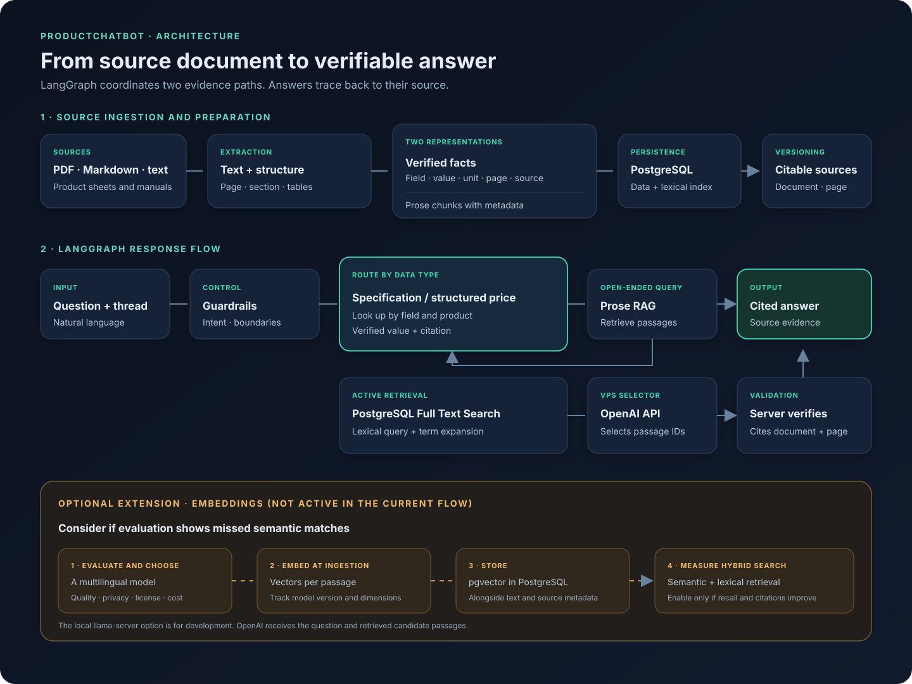

# productChatbot

## Useful answers, grounded in evidence you can check

A conversational assistant for product documents and pricing. Its answers trace back to their sources: technical specifications are extracted into records with page references, and open-ended questions retrieve passages from product documents. When the evidence is insufficient, the assistant does not fill in the gap by guessing.

**Stage:** working prototype · **Primary flow:** LangGraph · **Interface:** web chat

> The source repository is private. This folder presents the product and its technical decisions without credentials, customer data, or deployment secrets.

## The story

A chatbot can sound confident and still be wrong. In real tests, the relevant information was present, yet the system sometimes mixed up table rows, handed off unnecessarily, or returned text from the wrong section. For products with very different specs, each unsupported answer erodes trust.

The solution was to limit what the model can decide. Instead of asking it to invent and phrase technical specifications, the server extracts values from product sheets and stores them with their document, page, and evidence. For open-ended questions, OpenAI helps find relevant passages; the server returns those passages with citations. LangGraph connects both paths and keeps the conversation state.

The goal is to cover different product categories—such as routers, motor oil, and SSDs—using evidence from each source without hard-coding rules for a single category.

## How it works

1. **Ingest:** extract text, page numbers, sections, and tables from documents.
2. **Structure:** store verifiable specification rows with field, value, unit when present, page, section, and source. Prices are looked up from structured records, not retrieved from document text.
3. **Retrieve:** look up rows for specifications; use PostgreSQL Full Text Search to find passages for open-ended questions. OpenAI can suggest search terms and select evidence IDs.
4. **Verify:** the server returns stored values or selected passages, with citations. It rejects numerical claims it cannot support.
5. **Orchestrate:** LangGraph routes the request, keeps thread context, and supports human help when the user asks for it.

## Decisions behind the system

| Decision | Technology or mechanism | Why |
|---|---|---|
| Orchestrate the flow and conversation state | LangGraph with PostgreSQL checkpointing | Makes routing, validation, and human pause/resume explicit. |
| Store documents, facts, and lexical search in one engine | PostgreSQL and Full Text Search | Keeps source metadata beside the content and searches words, product codes, and measurements without another service. |
| Keep factual answers out of free-form model generation | Verified `facts` rows and structured price records | The server reads the value from its source and attaches the page citation. |
| Run the evidence selector on a VPS without a GPU | OpenAI API with JSON output | The model selects terms and evidence IDs; the application validates them and builds the answer from source material. `llama-server` remains an option for local development. |
| Return evidence instead of an unsupported paraphrase | Literal source passages with citations | Reduces the chance of changing units, figures, or qualifiers while rewriting. |
| Measure quality before changing the flow | HTTP regression sets, graph tests, and separate RAGAS evaluation | Helps distinguish retrieval, answer, citation, and handoff failures. |

When OpenAI is configured, the selector receives the user's question and retrieved candidate passages; it does not receive the original PDF file. The local `llama-server` option keeps that processing on the development machine.

## Embeddings: current decision and possible next step

**The current LangGraph path does not generate or query embeddings.** It retrieves text with PostgreSQL Full Text Search. The configured selector—OpenAI on the VPS, or the local model during development—expands search terms and selects candidate evidence. A vector column in the legacy schema does not mean vectors are currently being generated.

| Topic | Decision |
|---|---|
| Current status | No embeddings during ingestion or retrieval in the LangGraph flow. |
| Existing option | `pgvector` in PostgreSQL, avoiding a separate vector database. |
| Embedding model | Not selected yet. Compare multilingual quality, privacy, licensing, and cost on real Spanish and English queries first. |
| When to add embeddings | If evaluation shows that lexical search misses relevant evidence. |
| How to add them | Store versioned vectors by document and model, combine semantic and lexical search, and measure retrieval and citations before enabling the path. |
| Acceptance criterion | A measurable improvement in recall and precision on representative queries, without increasing unsupported answers. |

Embeddings are an evaluated extension, not a claim about the current implementation. The diagram distinguishes the active path from that future option.

## Data pipeline

### Document ingestion

`PDF / Markdown / text → extraction with page and section → table detection → verified facts + prose chunks → PostgreSQL`

Structured values keep their context and origin. The prose index serves open-ended questions and can be rebuilt when a document is updated.

### Chat response

`question → guardrails → catalog/spec lookup or prose RAG → candidate evidence → verification → cited answer`

If the requested information has no supporting evidence, the assistant says so. A human handoff is not used as an automatic substitute for a failed search.

## Evaluation

A 100-question regression suite passed with the local evaluation selector. It covers specifications, prose, language changes, follow-ups, product identity, synthetic prices, missing facts, and guardrails. Additional tests used oil and SSD documents to check whether the same retrieval mechanism works across product categories.

A five-case spot check with the OpenAI selector matched the expected facts and citations. The prose passages were accurate but sometimes too long, and Spanish questions received English source excerpts. The 100-question suite has not yet been rerun with OpenAI.

These results describe the tested cases; they do not guarantee that every new document will be extracted or retrieved correctly. RAGAS is a separate tool for measuring context coverage and faithfulness, factual precision, and answer coverage. Its scores are reported separately from exact-match checks.

## Technology stack

| Area | Technologies |
|---|---|
| API and web application | Python, FastAPI |
| Conversation flow | LangGraph |
| Persistence and lexical retrieval | PostgreSQL, Full Text Search |
| PDF processing | PyMuPDF4LLM |
| VPS evidence selector | OpenAI API; local `llama-server` for development |
| Containers | Docker Compose |
| Quality | pytest, HTTP regressions, separate RAGAS evaluation |

## Scope of this showcase

This README describes the primary LangGraph flow. The prototype also retains an earlier base implementation; the decisions here refer to LangGraph and should be revisited if that scope changes. No local URLs, credentials, private documents, or public deployment instructions are included.
